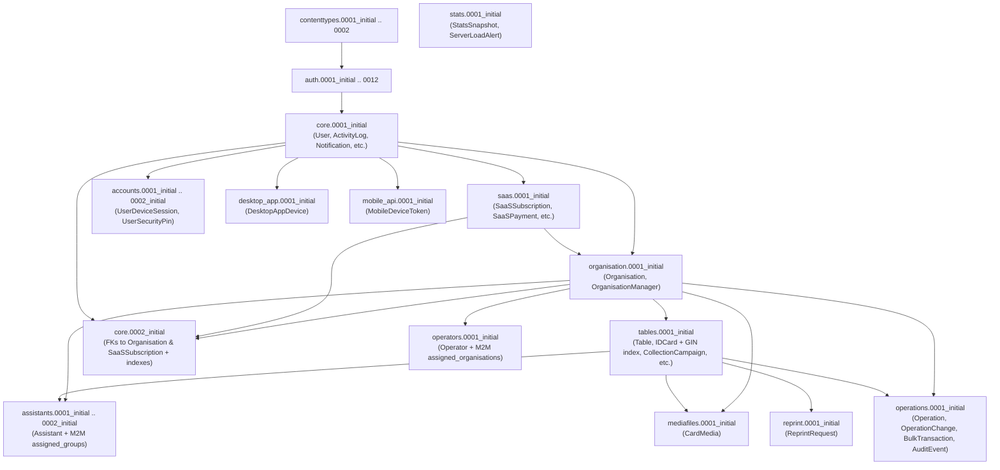

# Pro-Panel Django Migration Guide (`MIGRATION_GUIDE.md`)

> [!NOTE]
> This guide documents how the rebuilt Pro-Panel migration system is structured, the exact cross-app dependency DAG, how to add new migrations safely, and how to validate migration health in CI/CD and before deployment.

---

## 1. Migration Architecture Overview

All 182 legacy migrations (and all `SeparateDatabaseAndState` workarounds) have been replaced by a clean, deterministic baseline of **16 initial application migrations** across the 13 model-owning local apps (plus Django's built-in `contenttypes`, `auth`, and `sessions` migrations, totaling **31 migrations** in the complete graph).

### 1.1 Complete Migration Inventory & Dependency Graph



### 1.2 Why `core`, `accounts`, and `assistants` Have `0001_initial` + `0002_initial`

Django automatically splits initial migrations into `0001_initial.py` (table creation) and `0002_initial.py` (foreign key & index addition) whenever two apps have mutual foreign-key references:
- `core.User` has `subscription = ForeignKey('saas.SaaSSubscription')`, while `saas.SaaSPayment` references `core.User`.
- `core.ClientMessage`, `core.ClientPresenceSession`, and `core.PhotographerAssignment` reference `organisation.Organisation`, while `organisation.Organisation` references `core.User`.
- `assistants.Assistant` references `tables.Table` (`assigned_groups` M2M) and `organisation.Organisation`.

Because every model now lives in its canonical `app_label`, Django resolves this automatically using standard `initial = True` two-part migrations (`0001_initial` + `0002_initial`) with **zero** circular dependencies and **zero** manual hacks.

---

## 2. Rules for Authoring Future Migrations

1. **Never Use `SeparateDatabaseAndState` to Move Models Across Apps**:
   - Every model must remain in its owning domain app (`app_label` matching the app folder).
2. **Never Add `db_column` Overrides for Legacy Naming**:
   - Always use clean column names in the database. If Python backward compatibility is required for an old attribute name, implement a `@property` getter/setter on the model class.
3. **Always Use 64-Bit Integer Fields for Generic IDs**:
   - When storing an untyped or generic primary key reference (such as `target_id`), always use `models.BigIntegerField` or `models.PositiveBigIntegerField`, never `IntegerField`.
4. **Keep PostgreSQL-Specific DDL Guarded by `connection.vendor == 'postgresql'`**:
   - Example: The `idcard_field_data_gin` GIN index in `tables/migrations/0001_initial.py` checks `if schema_editor.connection.vendor == "postgresql":` so tests can run on both PostgreSQL and SQLite.
5. **Never Use `--fake` or `--fake-initial`**:
   - Every migration must apply cleanly from zero on a fresh PostgreSQL database.

---

## 3. Standard Migration Workflow

### 3.1 Generating a New Migration
```bash
cd backend
python manage.py makemigrations
python manage.py makemigrations --check --dry-run
```

### 3.2 Verifying Migrations Against a Fresh Disposable PostgreSQL Database
Before committing any schema or model change, run the automated rebuild test script:
```bash
bash backend/scripts/database_rebuild_test.sh
```
Or run the individual verification tools directly:
```bash
python backend/scripts/verify_migrations.py
python backend/scripts/verify_database_schema.py
python backend/scripts/database_health_check.py
```

